# Software Factory — Product Strategy & PRD

Nov 17, 2026 · Exported from the live doc: https://claude.ai/artifact/S5B49cU3k84EL3ZrmvJMe1 (the live doc is the source of truth; status columns are tracked there)

Source blueprint: [Softwar Factory Blueprint.pdf](../blueprint/Softwar%20Factory%20Blueprint.pdf)

## Product vision

Software Factory is an open-source framework that turns everyday requests into merged, proven code — with humans deciding and agents doing the work. Work arrives where people already are (GitHub first), a router turns it into jobs, and every job is specified, built test-first, reviewed by independent agents and gated by deterministic checks before it reaches main.

**Vision statement:** Any team can install a trustworthy agentic assembly line into any repository with one command, and trust what comes off it because the evidence is attached to every PR.

Three principles from the blueprint are non-negotiable and shape every stage:

| Principle | What it means in the product |
| --- | --- |
| Gates are code | Pass/fail is decided by `gate.py` (format, lint, types, build, tests, coverage, mutation), never by an LLM's opinion. |
| The author never grades the work | Tests are written from the spec and locked before implementation; verification and review are separate agents, often cross-model. |
| State lives in files | `STATE.md`, task files, handoffs, ADRs and glossary live in git, so any session or any tool can pick up where the last one stopped. |

**Why now:** coding agents are capable but unaccountable. Teams lack a repeatable workflow that bounds cost, prevents self-grading and proves correctness. The factory supplies that workflow as plain files plus a thin control plane.

## Product strategy

We win by shipping the trust layer first — gates, state and roles as plain files — and only then the automation that drives them. An open-source kit that works by hand in Claude Code, Copilot and Cursor is useful on day one; the router, intake and dashboard multiply it.

**Decisions confirmed (17 Nov 2026, two rounds)**

| Decision | Choice |
| --- | --- |
| Delivery model | Open-source framework |
| Timeline | No fixed horizon: stages sequenced by exit gates, not dates |
| Agent runtimes in v1 | Claude Code, GitHub Copilot and Cursor, compiled from one neutral source |
| Stack profiles in v1 | Python and TS/JS gate M1; C++, Go, Rust, .NET, Lua and Unreal land before v1.0 |
| First intake channel | GitHub (issues, PR comments, labels) |
| Control-session hosting | User's choice: local machine or cloud + local daemon, via config |
| Job index | SQLite |
| License | Apache-2.0 |
| Factory implementation language | Python 3.11+ |
| CI providers in v1 | GitHub Actions, GitLab CI, Azure Pipelines, Jenkins |
| Cross-model review | Pluggable vendors; OpenAI is the default non-Anthropic reviewer |
| Unreal profile | UE 5.4+, validated on a build machine you provide, through the daemon |
| Mutation gate | Changed lines only; 60% default; configurable per repo |
| Line Monitor dashboard | Local web app served by the daemon, reading SQLite; token auth in cloud mode |
| Default budgets | $15 per job, $120 per day; warn at 80%, halt at 100% |
| Review round limit | 3 rounds, then a human decides; configurable per track |
| Telemetry | None by default; opt-in local metrics only |

**Target users** (the blueprint's three human roles)

- **Product owner** — files a request, answers the spec interview, approves acceptance criteria.
- **Approver** — merges low-risk PRs, resolves escalations and blocked tasks.
- **Factory operator** — installs the kit, tunes gates, standards, budgets and model routing.

**Strategic bets**

1. **Foundation before automation.** Layers L1–L3 (State, Gates & evidence, Knowledge) ship first because every later layer reads and writes them.
2. **Tool-neutral by construction.** One neutral agent/skill source compiled per tool avoids lock-in and widens adoption.
3. **Evidence as the product.** Every PR carries a gate report, AC trace and findings; adoption is earned by auditability, not demos.
4. **Bounded autonomy.** Round limits, cost budgets and a watchdog make runaway spend a non-event, which is what lets teams turn it on.

**Success measures** for v1.0 (measured on the Line Monitor; starting targets, revisited after M3)

- First-pass gate rate: at least 80%
- Median cycle time, request → merge (full track): 4 hours or less
- Jobs needing a human: 20% or fewer
- Jobs finishing within budget: 95%
- Intake filter: drops at least 90% of noise, wrongly drops under 2% of real requests

## Staged breakdown

The build runs in seven stages (0–6), ordered bottom-up through the blueprint's layers: what every other part reads and writes comes first. 30 epics, each a trackable chunk with a clear done-when; each stack profile and each connector becomes its own ticket under its epic.

| ID | Stage | Epic | Delivers (blueprint path) | Depends on | Done when |
| --- | --- | --- | --- | --- | --- |
| E01 | 0 Foundation | Repo skeleton and installer v0 | `install/install.py`, `.agentic/` layout, `config.toml` schema | — | One command drops the skeleton into an empty repo and an existing one; Python 3.11+, Apache-2.0 |
| E02 | 0 Foundation | State files | `STATE.md`, `tasks/`, `handoffs/`, `docs/adr`, `GLOSSARY.md` | E01 | A second session resumes a task from files alone |
| E03 | 0 Foundation | Agent schema and tool scoping | `agents/_schema.md`, `model_hint`, per-role tool lists | E01 | A role cannot call a tool outside its list; locked tests reject edits |
| E04 | 0 Foundation | Definition-of-done templates | `workflow/templates` for spec, task, ADR, PR evidence | E02 | Templates validated by a linter in the gate |
| E05 | 1 Gates | Gate engine core | `gates/gate.py`: format, lint, types, build, tests, coverage, mutation; machine-readable report | E01 | Deterministic pass/fail with the same result on rerun; mutation scored on changed lines, 60% default |
| E06 | 1 Gates | Stack profiles (Python and TS/JS, 2 tickets) | `gates/profiles/*.toml` for Python and TS/JS (the rest move to E30) | E05 | Each profile passes a reference repo and fails a seeded-bug repo |
| E07 | 1 Gates | Hooks and CI | `gates/hooks`, `ci/` for GitHub Actions, GitLab CI, Azure Pipelines, Jenkins | E05 | Same gate verdict locally, on commit and in CI |
| E08 | 1 Gates | PR evidence | `skills/pull-request-evidence`: gate report, AC trace, findings | E04, E05 | Every PR has evidence a reviewer can audit without rerunning |
| E09 | 2 Knowledge | 16 core role definitions | `agents/core` (Spec Writer through Retro) | E03 | Each role has scope, tools, inputs, outputs and a model hint |
| E10 | 2 Knowledge | Skills library (16) | `skills/*/SKILL.md`: TDD slices, threat check, handoff, debugging… | E09 | Each skill exercised in at least one end-to-end run |
| E11 | 2 Knowledge | Standards packs (12) | `standards/`: PEP 8, Google C++, Uber Go, StyleCop… | E06 | Standards Reviewer cites pack rules by id |
| E12 | 2 Knowledge | Tool adapters | `adapters/build.py` compiling to Claude Code, Copilot, Cursor | E09, E10 | The same role runs in all three tools from one source |
| E13 | 3 Worker | Full-track pipeline | `workflow/pipeline.md`: spec → design → test (lock) → build → gate → review → docs → ship → learn | E08, E12 | One job runs end to end with human spec approval and merge |
| E14 | 3 Worker | Review loop and round limits | 5 isolated reviewers, max 3 rounds, then escalate to a human; limit configurable per track | E13 | Round 4 never happens without a human decision |
| E15 | 3 Worker | Lite track and pass-through | `workflow/tracks.md` (dep bumps, red main) | E13 | A dep bump ships on the lite track with full gates |
| E16 | 3 Worker | Machine daemon and worktrees | `runner/run.py --daemon`, worktree per job, cost and turn caps | E05 | Parallel jobs never share a worktree; caps halt a job |
| E17 | 3 Worker | Integrator and merge risk | Commit, PR, merge-risk rating, human merge checkpoint | E08, E13 | Low-risk vs high-risk routing matches the rating |
| E30 | 3 Worker | Remaining stack profiles (6 tickets) | `gates/profiles/*.toml` for C++, Go, Rust, .NET, Lua, Unreal (UE 5.4+) | E06, E16 | Each passes a reference repo and fails a seeded-bug repo; Unreal runs on your build machine; all land before M5 |
| E18 | 4 Control | Job index | SQLite job DB alongside `.agentic/` | E02 | Any session resumes any job after a crash |
| E19 | 4 Control | Router session | Long-lived orchestrator: track choice, dispatch, checkpoints, replies | E13, E18 | Router runs several workers in parallel unattended |
| E20 | 4 Control | Model router | strong / any / different-from hints → Opus, Sonnet, OpenAI by default for cross-model | E03 | Cross-model reviewers really run on a different model |
| E21 | 4 Control | Cost controls | Defaults $15 per job, $120 per day; warn at 80%, halt and hand off at 100% | E18 | A blown budget halts within one turn and files a handoff |
| E22 | 4 Control | Watchdog | `control/watchdog`, 5-minute heartbeat, repair or escalate | E16, E18 | Stalled workers, dead daemons and orphaned worktrees are fixed or escalated |
| E23 | 4 Control | Hosting modes | Local-only and cloud + local daemon, chosen in config | E19, E16 | Both modes pass the same end-to-end suite |
| E24 | 5 Intake | GitHub connector and reply channel | `intake/connectors/github`, `/foundry approve · reject · ask` | E19 | An issue becomes a job; status and approvals flow back to its thread |
| E25 | 5 Intake | Two-stage filter | `intake/filter.toml` rules, then cheap-model triage | E24 | Noise drop rate and false-drop rate reported per day |
| E26 | 5 Intake | More connectors | CI results, Slack/Teams, email and calendar | E25 | Each connector ships behind the same filter and reply contract |
| E27 | 6 Visibility | Line Monitor dashboard | Local web app served by the daemon from SQLite: job board, approvals queue, gate health, spend; token auth in cloud mode | E19, E21 | Every "Needs you" item can be acted on from the board |
| E28 | 6 Learning | Retro loop | Recurring failures → new checks and standards | E13 | A repeated failure produces a proposed gate or standard change |
| E29 | 6 Ecosystem | Domain experts and Release Manager | Template + accessibility, aerospace, Unreal experts; semver release flow | E09 | A third party adds a domain expert from the template alone |

## Timeline and milestones

With no fixed horizon, the timeline is a sequence of exit gates: a stage starts only when the milestone before it passes its criteria. M1 is the first usable open-source release; M5 is v1.0.

```mermaid
flowchart TD
    S0["Stage 0 · Foundation (E01–E04)<br/>Installer, state files, agent schema, DoD templates"]
    S1["Stage 1 · Gates and evidence (E05–E08)<br/>Gate engine, Python and TS/JS profiles, 4 CI providers, evidence"]
    S2["Stage 2 · Knowledge and adapters (E09–E12)<br/>16 roles, 16 skills, 12 standards packs, 3 tool adapters"]
    M1{{"M1 · Manual factory (alpha)<br/>A person drives a full-track job in Claude Code, Copilot and Cursor;<br/>the same gate verdict holds locally and in CI"}}
    S3["Stage 3 · Worker pipeline (E13–E17, E30)<br/>Tracks, review rounds, daemon, integrator, 6 more profiles"]
    M2{{"M2 · One job, end to end<br/>A CLI-started job reaches a merge-ready PR with evidence;<br/>humans only approve the spec and the merge"}}
    S4["Stage 4 · Control plane (E18–E23)<br/>Job DB, router, model routing, budgets, watchdog, hosting"]
    M3{{"M3 · Unattended line<br/>Parallel jobs survive a crash and a blown budget<br/>without a human restart, in local and cloud modes"}}
    S5["Stage 5 · Intake (E24–E26)<br/>GitHub connector, two-stage filter, CI, Slack, email"]
    M4{{"M4 · Work arrives on its own<br/>A GitHub issue becomes a merged PR;<br/>status and approvals reply in the same thread"}}
    S6["Stage 6 · Visibility and learning (E27–E29)<br/>Line Monitor, retro loop, domain experts, releases"]
    M5{{"M5 · v1.0 public release<br/>Line Monitor live, retro proposes new checks,<br/>a third party adds a domain expert from the template"}}
    S0 --> S1 --> S2 --> M1 --> S3 --> M2 --> S4 --> M3 --> S5 --> M4 --> S6 --> M5
```

Stages 0–2 can partly overlap (Stage 1 needs only the skeleton from E01), but nothing above M1 starts until gates, roles and adapters all work by hand.

## Strategic opportunities

The biggest opportunity is that the lower three layers are valuable on their own, so the project can earn users and contributors from Stage 1 onward, long before full automation.

| Opportunity | Unlocked by | Why it matters |
| --- | --- | --- |
| Standalone gate engine | M1 (E05–E08) | Teams with no agents still want one deterministic gate across 8 stacks locally and in CI; a low-friction entry point to the framework. |
| De facto neutral agent format | M1 (E12) | One source compiled to Claude Code, Copilot and Cursor can become the shared format for roles and skills; contributors write once. |
| Community packs | M1 (E10, E11), M5 (E29) | Standards packs, skills and domain experts are plain files; third parties can publish them like plugins. |
| Evidence-based PRs as a compliance story | M2 (E08, E17) | AC trace + gate report on every PR serves regulated domains (the blueprint names aerospace). |
| Cross-model review as a quality moat | M3 (E20) | "Different-from" model hints make the author-never-grades principle real across vendors. |
| Game and engine teams | M5 (E30 Unreal profile, E29) | Few agentic workflows support Unreal/C++ builds needing local hardware; the machine daemon fits that gap. |
| Hosted control plane later | M3–M5 | Open-source first keeps the door open to an optional hosted router and dashboard; not in scope until decided. |

## Open questions

Eleven of the twelve were answered on 17 Nov 2026 and now live in the decisions table and success measures. One remains, and it is not assumed anywhere above:

- [ ] **Dogfood repos** — the factory's own repo validates the Python profile; name a real TS/JS repo for M1, and one repo per remaining profile before E30 closes (C++, Go, Rust, .NET, Lua, Unreal).
